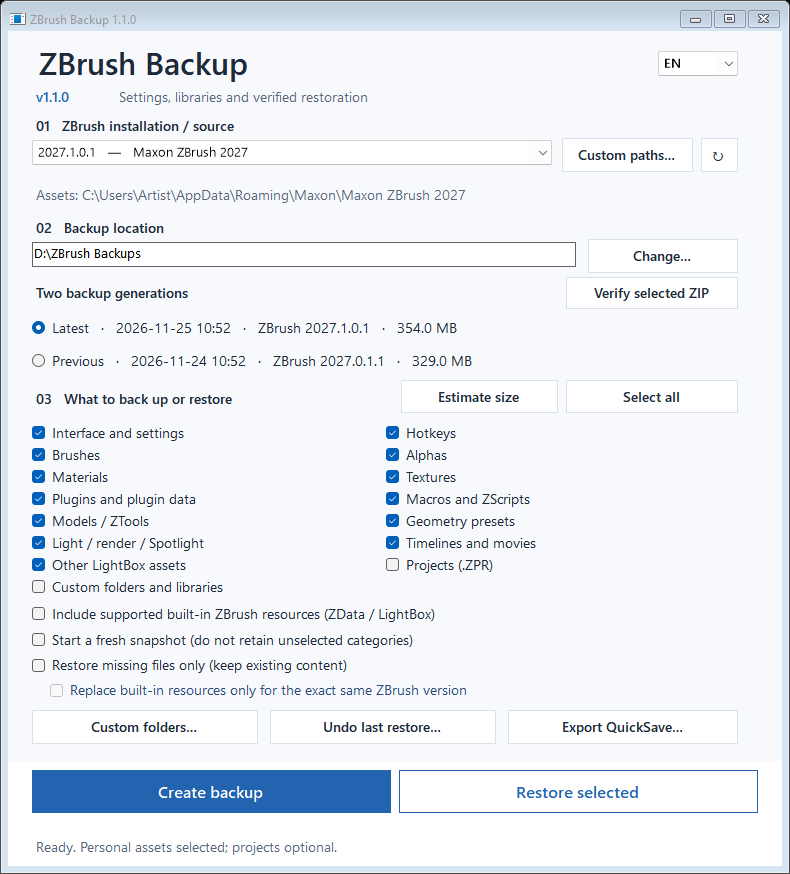
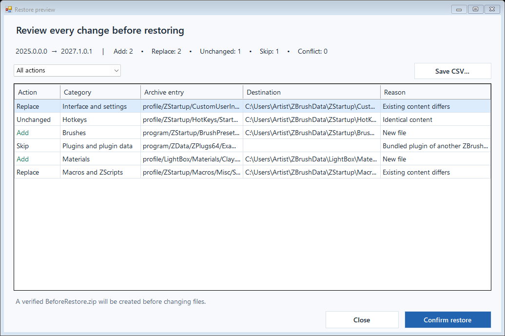

# ZBrush Backup

**Сохрани рабочее пространство. Перенеси. Восстанови.**

Бесплатная портативная программа для Windows, которая помогает сохранять и переносить настройки ZBrush, кисти, плагины и собственные библиотеки при обновлении ZBrush, переустановке Windows или переходе на другой компьютер.

**[Скачать для Windows бесплатно](https://github.com/Alsoilia/ZBrush-Backup/releases/latest)** · **[Поддержать разработку на Boosty](https://boosty.to/traymetry/donate)** · [English](README.md)

Все возможности доступны бесплатно. Донаты исключительно добровольные — без платных функций, подписки, аккаунта или онлайн-активации.

## Возможности

- Выбор 15 категорий для резервного копирования: интерфейс, горячие клавиши, кисти, альфы, материалы, текстуры, плагины, макросы, ZTools, пресеты геометрии, ресурсы освещения и рендера, таймлайны, другие ресурсы, проекты и пользовательские библиотеки.
- Два проверяемых поколения архивов: `Latest.zip` и `Previous.zip`. При частичном обновлении архива из того же источника невыбранные категории сохраняются со своими датами; также можно создать новый архив только из выбранных категорий.
- Режим сохранения собственных ресурсов или с поддерживаемыми штатными файлами ZBrush. Можно указать свои пути к программе, ZBrush Asset Directory и резервным копиям. Доступна оценка количества файлов, размера и свободного места.
- Предпросмотр восстановления без записи файлов: видны новые, заменяемые, сохранённые, пропущенные и конфликтующие файлы. Можно экспортировать список в CSV либо восстановить только отсутствующие файлы.
- Отмена последнего восстановления с проверяемым архивом `BeforeRestore.zip`. Изменённые после восстановления файлы защищены от перезаписи при отмене.
- По желанию — резервирование сохранённых ZPR-проектов. QuickSave можно отдельно экспортировать в датированный ZIP, не меняя обычные архивы настроек.

## Как пользоваться

1. На странице [последнего релиза](https://github.com/Alsoilia/ZBrush-Backup/releases/latest) скачайте `ZBrush-Backup-1.1.0-Windows-Standalone.zip` (или аналогичный Windows Standalone ZIP новой версии).
2. Распакуйте архив и запустите `ZBrush Backup.exe`. Инструкции на русском и английском входят в архив (`README-RU.txt`, `README-EN.txt`).
3. Выберите источник, папку для бэкапов и нужные категории. Создайте бэкап и дождитесь окончания проверки.
4. Для восстановления выберите установленную версию и архив, проверьте предпросмотр, закройте ZBrush и подтвердите восстановление. При необходимости используйте отмену последнего восстановления.

В релизе также есть `SHA256SUMS.txt` с контрольными суммами и отдельный необязательный архив исходников C#. Автоматические ссылки GitHub «Source code» содержат файлы этого репозитория с документацией, а не исходники приложения.

## Совместимость

- Windows с .NET Framework 4.8/4.8.1. Самостоятельное C#-приложение не запускает PowerShell, отдельные процессы для резервирования и сетевые операции; установщик и автоматическое повышение привилегий не используются.
- Проверена Windows 11, поиск установок ZBrush 2026.2 и 2027.1. Восстановление, отмена, прежние пути данных 2025/2026.0 и архивы формата 1 проверены на изолированных тестовых файлах. Windows 10, все остальные версии ZBrush и сторонние плагины отдельно не проверялись.
- При первом запуске — английский интерфейс. В программе можно выбрать русский или английский язык. macOS, iPad и ARM не заявлены как поддерживаемые платформы.

Это не полный бэкап установки ZBrush, системы или лицензии. Несохранённая работа не копируется. Обычные архивы настроек не включают файлы автовосстановления и типичные кэши. Храните независимую копию незаменимых файлов.

EXE не подписан сертификатом издателя. При срабатывании защиты остановитесь и сообщите о детекции автору или разработчику антивируса; отключать защиту не нужно. В комплекте нет программы ZBrush, лицензионных ассетов или личных бэкапов.

## Поддержка и обратная связь

Если программа пригодилась, можно [добровольно поддержать разработку на Boosty](https://boosty.to/traymetry/donate). Спасибо!

Об ошибках и пожеланиях можно написать в [Issues](https://github.com/Alsoilia/ZBrush-Backup/issues). Укажите версии программы, Windows и ZBrush, действие и текст ошибки. Не прикладывайте личные архивы, закрытые проекты и данные лицензий.

## Лицензия

[Лицензия](LICENSE.txt) разрешает личное и профессиональное использование, включая коммерческую художественную работу. Исходники предоставляются отдельно для ознакомления и собственной авторизованной сборки под той же лицензией, без разрешения на распространение. Это не лицензия открытого исходного кода.

ZBrush — товарный знак правообладателя. ZBrush Backup — независимая утилита, не связанная с Maxon и не одобренная им.
