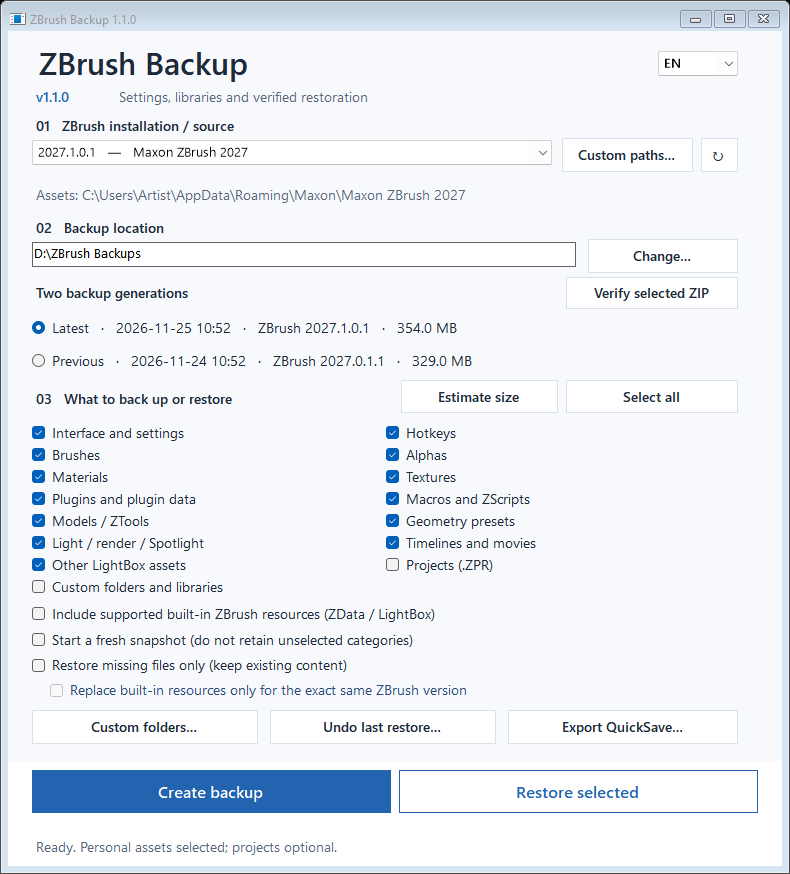
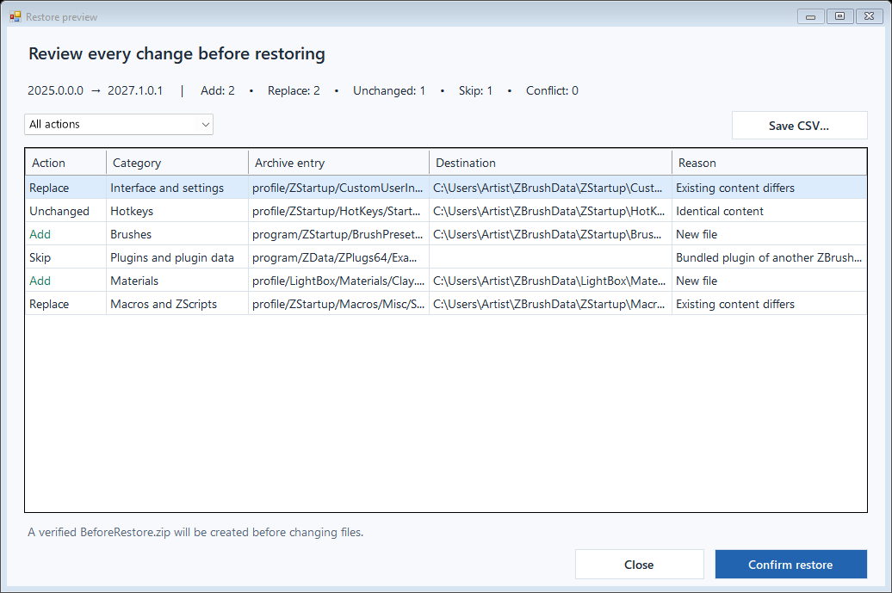

# ZBrush Backup

**Keep your workspace. Move it. Restore it.**

Free, portable Windows utility for backing up and migrating ZBrush settings, brushes, plugins and custom libraries. Built for 3D artists who want to keep their workspace when updating ZBrush, reinstalling Windows or moving to another computer.

**[Download for Windows (free)](https://github.com/Alsoilia/ZBrush-Backup/releases/latest)** · **[Support development on Boosty](https://boosty.to/traymetry/donate)** · [Русская версия](README-RU.md)

The complete application is free. Donations are entirely optional: there is no paid feature tier, subscription, account or online activation.

## What it does

- Select any of 15 backup categories, including interface settings, hotkeys, brushes, alphas, materials, textures, plugins, macros, ZTools, geometry presets, lighting and rendering resources, timelines, other assets, projects and custom libraries.
- Keep two verified local backup generations, `Latest.zip` and `Previous.zip`. Partial backups of the same source retain untouched categories and their earlier update dates; a fresh snapshot starts with only the currently selected categories.
- Back up personal resources only, or include supported built-in resources. Select your own ZBrush installation, asset directory and backup destination. See file counts, size estimates and available space before starting.
- Review a restore plan without writing files. See additions, replacements, kept files, skips and conflicts, export the plan as CSV, or restore missing files only.
- Undo the last restore with a verified `BeforeRestore.zip`; files changed since the restore are protected from being overwritten by Undo.
- Include saved ZPR projects when you choose. Export QuickSave to a separate dated ZIP without changing your regular settings archives.

## Download and use

1. Open the [latest release](https://github.com/Alsoilia/ZBrush-Backup/releases/latest) and download `ZBrush-Backup-1.1.0-Windows-Standalone.zip` (or the corresponding Windows Standalone ZIP for a newer version).
2. Extract the ZIP to a folder you control and run `ZBrush Backup.exe`. Read `README-EN.txt` or `README-RU.txt` included in the ZIP.
3. Choose your ZBrush source, backup folder and categories. Create the backup and wait for verification.
4. For a restore, select the installed destination and archive, preview the planned changes, close ZBrush and confirm the restore. Use Undo last restore if needed.

Use `SHA256SUMS.txt` from the release to check the downloaded ZIP and executable. The included source ZIP is optional, for review or building your own authorized copy; GitHub's automatically generated "Source code" links archive this repository's documentation, not the application sources.

## Compatibility

- Windows desktop with .NET Framework 4.8/4.8.1; the application is a standalone C# GUI, with no runtime PowerShell, installer, separate worker, automatic elevation or network calls.
- Windows 11 and discovery of ZBrush 2026.2 and 2027.1 were tested. Restore, Undo, older 2025/2026.0 data paths and format-1 archive support were checked on isolated synthetic files. Windows 10 and every other ZBrush version or third-party plugin have not been independently tested.
- English on first launch; English/Russian interface switch and both-language guides. macOS, iPad and ARM are not supported targets.

ZBrush Backup is not a full ZBrush installation, system or license backup. It does not recover unsaved work. Regular settings backups exclude automatic recovery files and common caches. Keep an independent copy of irreplaceable work, and inspect backups and restore plans before relying on them.

The distributed Windows executable is unsigned. If security software reports a problem, stop and report the detection details to the creator or security vendor; do not disable protection. No Maxon software, licensed assets or private backup archives are bundled with this download.

## Support and feedback

If the app saves you time, you can [send an optional donation on Boosty](https://boosty.to/traymetry/donate). Thank you for supporting continued development!

For a bug or suggestion, use the repository's [Issues](https://github.com/Alsoilia/ZBrush-Backup/issues). Include the app version, Windows and ZBrush versions, the action you took, and the error message. Please don't upload your personal backup archives, private project files or license data.

## License

The free download includes an individual-use [license](LICENSE.txt) for personal and professional artistic work, including commercial work. A separate C# source archive is provided under that same license for review and your own authorized use; it is not an open-source redistribution license.

ZBrush is a trademark of its respective owner. ZBrush Backup is an independent utility and is not affiliated with or endorsed by Maxon.
